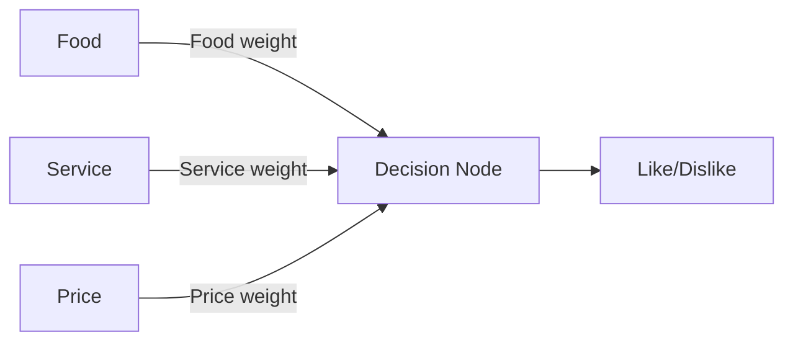

# Lab08: How a Neural Network Learns

**Team Member:** JiayingChen, Leslie Nguyen, Jihyun Park
**Date:** 2026-11-04

## 1. Objective
The objective of this lab is to understand how a neural network learns through predictions, 
feedback, and weight adjustments.

## 2. Network Structure
The network has three inputs: Food, Service, and Price. Each input has a weight representing its influence on the decision.

## 3. Team Roles

-Input Feeder: Jiaying Chen  
-Decision Node: Leslie Nguyen  
-Observers / Trackers: Jihyun Park  

## 4. Training Phase

### Input Feeder's Role
As the Input Feeder, I present the Food, Service, and Price features for each of the 10 training cards. I keep the customer opinion hidden until the Decision Node makes a prediction and the Observer/Tracker records it.

I then reveal the correct answer so the team can check the prediction. When a prediction is incorrect, I participate in the discussion about which features should have more influence and how the weights should change. We complete any adjustments before moving to the next card.

### Training Input
|Card|Food|Service|Price|
|----|----|-------|-----|
|1|Great|Poor|Cheap|
|2|Bad|Great|Expensive|
|3|Good|

## 5. Testing Phase
### Input Feeder's Role
During testing, I present the Food, Service, and Price features for Cards 11-13 without revealing the customer opinions. The Decision Node uses the final weights learned during training, which remain unchanged throughout testing.

After each prediction is recorded, I reveal the correct answer. Keeping the answer hidden until predictions are recorded helps the team assess its performance on the test scenarios.

## 6. Team Comparison

## 7. Reflection

### How did your predictions improve?

### How did weights help you learn?

### What would happen with more layers or input?

### How does this reflect how real AI works?
