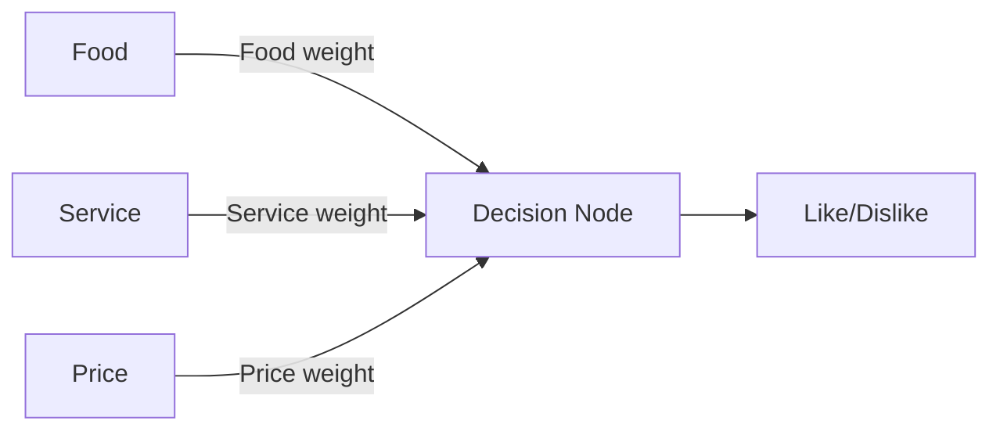

# Lab08: How a Neural Network Learns

**Name:** JiayingChen
**Student ID:** 116924267
**Date:** 2026-11-04

## 1. Objective
The objective of this lan is to understand how a neural network learns through predictions, 
feedback, and weight adjustments.

## 2. Network Structure
The network has three inputs: Food, Service, and Price. Each input has a weight representing its influence on the decision.

## 3. Team Roles

-Input Feeder:
-Decision Node:
-Observers / Trackers:

## 4. Training Phase

## 5. Testing Phase

## 6. Team Comparison

## 7. Reflection

### How did your predictions improve?

### How did weights help you learn?

### What would happen with more layers or input?

### How does this reflect how real AI works?
