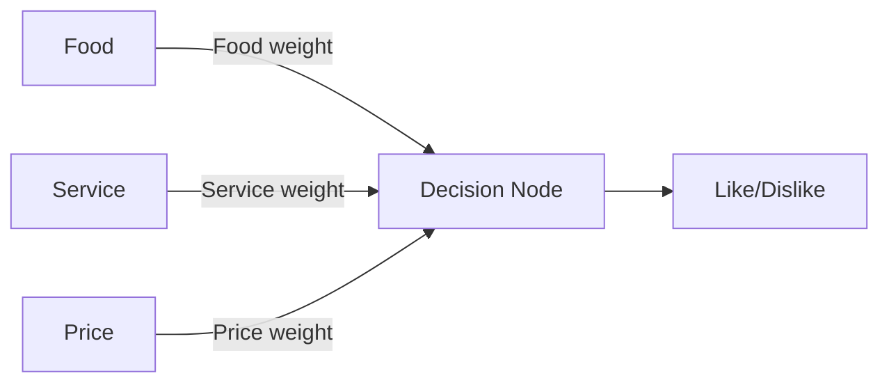

# Lab08: How a Neural Network Learns

- **Team Members:** Jiaying Chen, Leslie Nguyen, Jihyun Park
- **Date:** 2026-11-04

## 1. Objective
The objective of this lab is to understand how a neural network learns through predictions, 
feedback, and weight adjustments.

## 2. Network Structure
The network has three inputs: Food, Service, and Price. Each input has a weight representing its influence on the decision.

## 3. Team Roles

- Input Feeder: Jiaying Chen  
- Decision Node: Leslie Nguyen  
- Observers / Trackers: Jihyun Park  

## 4. Training Phase

### Training Procedure
For each training scenario, our team follows these steps:
1. The Input Feeder readers the three input features without revealing the correct answer.
2. The Decision Node predicts Like or Dislike using the current feature weights and explains the decision.
3. The Tracker records the prediction.
4. The Input Feeder reveals the correct customer opinion.
5. If the prediction is incorrect, the team discusses and adjusts
   the weights. The Tracker records the updated weights and reasons.

The updated weights are used for the next training scenario.

### Input Feeder's Role
As the Input Feeder, I present the Food, Service, and Price features for each of the 10 training cards. I keep the customer opinion hidden until the Decision Node makes a prediction and the Observer/Tracker records it.

I then reveal the correct answer so the team can check the prediction. When a prediction is incorrect, I participate in the discussion about which features should have more influence and how the weights should change. We complete any adjustments before moving to the next card.

### Decision Node's Role
As the Decision Node, I use the current token weights to predict LIKE or DISLIKE for each card. I state my prediction before the answer is revealed, so the Observer/Tracker can record it.

When I’m wrong, I explain my reasoning so the team can see which feature misled me. I then use the updated weights for the next cards, and the final weights for the test set.

### Tracker's Role
As the Observer/Tracker, I record the Decision Node's prediction for each training card before the correct answer is revealed. After the reveal, I mark the prediction as correct or incorrect and update the running total of correct predictions.

When a prediction is wrong, I take part in the discussion by suggesting which feature should receive more tokens. I then record the updated weights and the reason for the change, so the team can see how the weights evolve over the 10 cards.

### Input Encoding
We convert the input features into numerical scores.
These scores represent the input values, not the feature weights.

| Feature | +1 | 0 | -1 |
|---|---|---|---|
| Food |Great, Excellent, Good |Okay|Poor, Bad|
| Service| Great, Excellent, Good | Okay | Poor, Bad |
| Price | Cheap | Moderate | Expensive |

### Initially Weight
- Food: 1
- Service: 1
- Price: 1

### Prediction Rule

Score = (Food value × Food weight)
      + (Service value × Service weight)
      + (Price value × Price weight)

- Score > 0: Like
- Score <= 0: Dislike

### Training Input
|Card|Food / Service / Price|Weights (F/S/P)|Score|Prediction|Actual|Result|
|----|----------------------|---------------|-----|----------|------|------|
|1|Great/Poor/Cheap|1/1/1|+1/-1/+1=1|LIKE|LIKE|Correct|
|2|Bad/Great/Expensive|1/1/1|-1/+1/-1=-1|DISLIKE|DISLIKE|Correct|
|3|Good/Okay/Moderate|1/1/1|+1/+0/+0=1|LIKE|LIKE|Correct|
|4|Poor/Poor/Cheap|1/1/1|-1/-1/+1=-1|DISLIKE|DISLIKE|Correct|
|5|Excellent/Excellent/Expensive|1/1/1|+1/+1/-1=+1|LIKE|LIKE|Correct|
|6|Okay/Bad/Moderate|1/1/1|+0/-1/+0=-1|DISLIKE|DISLIKE|Correct|
|7|Great/Okay/Cheap|1/1/1|+1/+0/+1=2|LIKE|LIKE|Correct|
|8|Poor/Excellent/Expensive|1/1/1|-1/+1/-1=-1|DISLIKE|DISLIKE|Correct|
|9|Excellent/Poor/Moderate|1/1/1|+1/-1/+0=0|DISLIKE|LIKE|Incorrect|
|10|Okay/Okay/Expensive|2/1/1|+0*2/+0/-1=-1|DISLIKE|DISLIKE|Correct|

After reviewing the prediction results, our team increased the Food weight from 1 to 2 while keeping the Service and Price weights at 1. We then tested the updated weights using Training Cards 1–9. All nine predictions were correct, so we decided to keep the updated weights for the remaining training cards and testing phase.  
**Updated Score = (Food value × 2 Food weight)
      + (Service value × Service weight)
      + (Price value × Price weight)**

## 5. Testing Phase
### Input Feeder's Role
During testing, I present the Food, Service, and Price features for Cards 11-13 without revealing the customer opinions. The Decision Node uses the final weights learned during training, which remain unchanged throughout testing.

After each prediction is recorded, I reveal the correct answer. Keeping the answer hidden until predictions are recorded helps the team assess its performance on the test scenarios.

### Decision Node's Role
During testing, I predict LIKE or DISLIKE for Cards 11–13 using the final weights from training, without changing them. I state each prediction before the answer is revealed, so the Observer/Tracker can record it.

### Tracker's Role
During testing, I record the Decision Node's prediction for Cards 11-13 before the answer is revealed. The weights are not changed during this phase. After each reveal, I mark the prediction as correct or incorrect, then compare the testing accuracy with the training accuracy.

### Test Inputs
|Card|Food / Service / Price|Weights (F/S/P)|Score|Prediction|Actual|Result|
|----|----------------------|---------------|-----|----------|------|------|
|11|Good/Excellent/Cheap|2/1/1|+1*2/+1/+1=5|LIKE|LIKE|Correct|
|12|Bad/Bad/Expensive|2/1/1|-1*2/-1/-1=-5|DISLIKE|DISLIKE|Correct|
|13|Excellent/Great/Moderate|2/1/1|+1*2/+1/+0=3|LIKE|LIKE|Correct|

## 6. Team Comparison
reimir jashari
Bryan Velasco

## 7. Reflection

### How did your predictions improve?

At the beginning, our team used equal weights of 1 for all three features. After reviewing the predictions, we increased the Food weight from 1 to 2 because we wanted Food to have more influence on the final decision. With the updated weights, our predictions for Training Cards 1–9 were correct when we tested them again. We also correctly predicted all three testing cards. This showed that adjusting the weights helped improve our predictions.

### How did weights help you learn?

Weights helped us understand that each input feature can have a different level of influence on the final decision. By increasing the Food weight, we made Food more important than Service and Price. We learned that changing weights can affect the final score and help the network make better predictions based on the feedback it receives.

### What would happen with more layers or input?

With more inputs, the network could consider additional factors such as restaurant cleanliness, atmosphere, and waiting time. This could help it make more detailed decisions. More layers could also allow the network to recognize more complex patterns and relationships between different features. However, the network might need more training data and time to learn accurately.

### How does this reflect how real AI works?

This lab demonstrates a basic idea of how real AI systems learn. A neural network receives input data, calculates an output using weights, and compares its prediction with the correct answer. During training, the weights are adjusted based on errors to improve future predictions. Real AI systems use much more complex networks and larger amounts of data, but the basic idea of learning through feedback and weight adjustments is similar.
